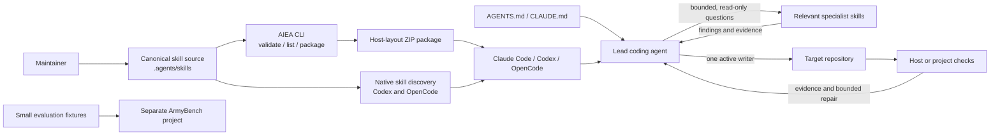

# AIEA v1 architecture

This is the normative architecture for AIEA 1.x. It keeps the portable workflow library separate from host-specific packaging and evaluation execution.

## System view

AIEA supplies instructions and a packaging tool. The host supplies models, tools, permissions, agent processes, and repository access. The target application repository supplies its build and runtime checks. ArmyBench supplies evaluation execution in a separate project.

## Components and contracts

### 1. Canonical skills

`.agents/skills/<skill-name>/SKILL.md` is the source of truth. Every skill follows the Agent Skills format, uses a stable name that matches its directory, and has a concise activation description. Supporting resources live beside that skill. Specialist skills describe read-only scope and a concise findings format.

Changes to canonical skills flow outward through packages. Host-specific instructions must not silently fork the workflow contract.

### 2. AIEA CLI

`tools/aiea.py` is a local, dependency-free maintenance and packaging tool. It:

- checks skill frontmatter, names, directories, version metadata, required docs, and fixture JSON;
- lists skills by core or specialist group;
- creates a ZIP with skills in a selected host-compatible project path and a manifest containing file hashes.

The CLI reads repository files and writes only the package requested by its caller. It does not install packages into a project, change host settings, contact a network, or execute skill scripts. Existing archives are never overwritten.

### 3. Host activation and adapters

Each host can discover skills using its own directory conventions. AIEA keeps one canonical source tree and builds host-layout archives only where the directory differs. Current paths and limitations are recorded in `docs/host-compatibility.md` and the adapter READMEs.

Hybrid activation means native discovery is the default when supported; `aiea-bootstrap` describes manual discovery for sessions where that is unavailable or unclear. AIEA never claims a host loaded a skill without evidence.

### 4. Delegation protocol

The lead agent scopes work and may ask independent specialists bounded read-only questions. Specialists return findings with evidence and open questions; they do not modify shared code. The lead reviews findings and performs shared-tree integration as the single active writer. If the host cannot run specialists independently, the lead uses the same contracts directly and reports the limitation when relevant.

### 5. Verification and repair

The lead chooses checks appropriate to the behavior changed, inspects their results, and reports passed, failed, and unrun checks. Failed checks are diagnosed from evidence. Repairs are limited to a stated small budget; unresolved failures are reported rather than hidden.

### 6. Evaluation boundary

`evaluations/fixtures/` contains a few sanitized examples. ArmyBench is responsible for harnesses, execution, datasets, scoring, and the Next.js/FastAPI/PostgreSQL reference application. Core skills do not depend on ArmyBench.

## Data and trust boundaries

- Skill instructions and fixtures are reviewed repository content. Hosts execute them with the permissions already available to the agent.
- Third-party repository, issue, web, and specialist content is untrusted input and cannot override user or system instructions.
- The packaging tool copies skill files into a ZIP; it does not grant capabilities. Users inspect and deliberately install packages.
- No credentials or learner data belong in the framework repository.

## Versioning and change flow

The `VERSION` file identifies the framework package version. `docs/release.md` defines the release procedure. A release validates the canonical tree, creates and inspects packages for all supported hosts, records changes, and tags the source. The ZIP manifest identifies version, host, install path, skill names, and file hashes.

## Explicitly outside this architecture

No orchestration runtime, model router, service, application, automatic installer, telemetry system, plugin marketplace listing, or ArmyBench runner ships in v1. Future proposals must preserve the usability of the canonical skills without those components.
